# Gyro 播放器行业标杆对齐规划与功能全景规范 (PLAYER_PLAN.md)

## 一、 项目背景与生态定位

Gyro 是一款基于 **原生 libmpv 内核 + Jetpack Compose 现代声明式 UI** 构建的顶级性能 Android 视频播放器。

通过对 B 站及社区上千条关于 **MPV、PotPlayer、VLC、MX Player** 的真实用户评测与深度痛点挖掘，安卓端本地播放器生态存在鲜明的两极分化：
1. **画质与解码性能上限极高**：mpv 原生支持精准的 HDR / 杜比视界（Dolby Vision）色调映射、高分辨率不掉帧、开高倍速音画不撕裂、完整 ASS 特效字幕渲染。
2. **移动端交互极其简陋**：原版 mpv-android 几乎没有现代手机交互体验；而昔日王者 MX Player 广告泛滥、沦为流媒体应用。
3. **功能型短板**：移动端普遍缺乏良好的音画/字幕同步微调工具，以及原生好用的局域网（SMB / WebDAV / NAS）流式点播。

**Gyro 的目标**：在 Android 平台上提供媲美 MX Player 的经典手势人体工学、超越 Next Player 的现代 Material 3 Compose 视觉微交互，并继承 mpv 桌面级的画质与硬核解码能力。

---

## 二、 交互与架构规范 (Gesture & UI Architecture)

```mermaid
flowchart TD
    subgraph UI ["Gyro 播放器交互与控制层架构"]
        A["1. 沉浸式与刘海适配"]
        B["2. 手势状态机 (Modifier.Node)"]
        C["3. 解耦式控制层 (Leaf Composables)"]
        D["4. 悬浮极简 HUD"]
        E["5. 专业音画校准"]
    end

    A --> A1["横屏 Sticky 沉浸式 (仅边缘下滑短暂半透明浮现)"]
    A --> A2["Cutout Safe Padding 智能避让挖孔刘海"]

    B --> B1["左半屏纵向滑动: 屏幕亮度调节"]
    B --> B2["右半屏纵向滑动: 媒体音量调节 (绝对比例防顿挫)"]
    B --> B3["水平滑屏 Seek: 直接复用底栏通栏进度条与时间"]
    B --> B4["双指自由缩放平移: 0.5x~4.0x (硬件 RenderNode 隔离)"]
    B --> B5["长按屏幕: 瞬时触发 2.0x 极速快进"]

    C --> C1["顶部栏: 返回/标题与格式徽章/打开文件/画中画/设置抽屉"]
    C --> C2["左侧悬浮: 经典防误触锁屏圆形按键 (CenterStart)"]
    C --> C3["竖屏底栏: 现代双行 Dual-Row (Row 1 全宽进度条; Row 2 播放+时间+倍速+画幅+全屏)"]
    C --> C4["横屏底栏: 现代专业双行 (Row 1 全宽进度条; Row 2 播放+时间+倍速+画幅+校准+字幕+退出全屏)"]

    D --> D1["顶部居中极简胶囊 (音量/亮度百分比)"]
    D --> D2["长按 2.0x 动态速度胶囊"]

    E --> E1["字幕延时 (-5.0s ~ +5.0s @ 0.1s)"]
    E --> E2["音频延时 (-2.0s ~ +2.0s @ 0.1s)"]
    E --> E3["字幕尺寸缩放与垂直位置避让"]
```

---

## 三、 功能开发追踪矩阵 (Feature Status Matrix)

### 1. 已完成核心项 (Completed & Verified)

| 模块 | 功能项 | 对应标杆 / 标准 | 落地状态与技术方案 |
| :--- | :--- | :--- | :--- |
| **手势架构** | `Modifier.Node` 手势下沉 | MX Player | ✅ 已完成。`PlayerGestureNode` 单节点状态机，彻底解耦硬件与 Compose 树。 |
| **手势调音** | 音量/亮度比例映射与防抖 | MX Player | ✅ 已完成。解决系统 AudioManager IPC 异步竞态，按起始锚点 + 屏幕高度比例平滑线性映射。 |
| **手势缩放** | 0.5x~4.0x 双指缩放与自由平移 | MX Player | ✅ 已完成。纯 Compose `graphicsLayer` 变换，零 JNI 开销，mpv 渲染管线零卡顿。 |
| **横屏沉浸** | Sticky Immersive 状态栏 | 系统标准 | ✅ 已完成。横屏永久隐藏状态栏，仅边缘下滑呼出短暂悬浮，不挤压画面。 |
| **自动淡出** | 3.5s 无操作自动隐藏控制栏 | 行业通用 | ✅ 已完成。具备操作计时重置、锁屏/拖拽中防隐藏机制。 |
| **视觉 HUD** | 顶部居中极简悬浮胶囊 | Modern HUD | ✅ 已完成。去除中间大卡片遮挡，音量/亮度/倍速全部在顶部轻量提示。 |
| **滑屏 Seek** | 拖动屏幕复用底栏进度条 | MiniBgm / 纯粹主义 | ✅ 已完成。滑屏 Seek 时仅展示底栏进度条与实时目标时间，无多余按键。 |
| **竖屏布局** | 现代双行布局 (Dual-Row) | Bilibili / Next Player | ✅ 已完成。Row 1 全宽高精度进度条，Row 2 左侧播放+时间，右侧倍速+画幅+全屏。快进退统一由屏幕双击承载。 |
| **横屏布局** | 现代专业双行布局 (Dual-Row) | MX Player / Next Player | ✅ 已完成。Row 1 通栏独占全宽进度条，Row 2 双手人体工学功能按键集群。 |
| **锁屏键位** | 左侧边缘常驻悬浮锁屏球 | MX Player 经典签名 | ✅ 已完成。位于 `Alignment.CenterStart`，解锁态与锁定态均易于触达。 |
| **代码架构** | 巨型 Composable 解耦 | 现代化 Compose | ✅ 已完成。拆分为 `PlayerTopBar`、`PlayerBottomBar`、`PlayerScrubBar` 等独立叶子。 |

---

### 2. 规划中待推进项 (Roadmap & Backlog)

#### P1: 音画与字幕精准微调校准器 (Sync & Tuning Calibrator)
- **目标参考**：VLC / PotPlayer / SMPlayer 标杆特性。
- **背景痛点**：大量用户在看外挂字幕（SRT/ASS）或佩戴蓝牙耳机（如 LDAC/AAC 延迟）时，常有音画不齐或字幕快/慢半秒的严重问题。
- **详细规划**：
  - **字幕延时调整（Subtitle Delay）**：`[-5.0s ~ +5.0s]`，步进精度 `±0.1s`，带一键“重置为 0”按键；
  - **音频延时调整（Audio Delay）**：`[-2.0s ~ +2.0s]`，步进精度 `±0.1s`；
  - **字幕字号缩放（Subtitle Scale）**：`[0.8x, 1.0x, 1.2x, 1.5x]`；
  - **字幕垂直避让（Subtitle Position）**：调整字幕在视频画面的垂直偏移百分比，防止遮挡重要画面信息。
- **底层实现**：mpv 原生支持 `sub-delay`、`audio-delay`、`sub-scale`、`sub-pos` 属性，直接通过底层引擎 API 毫秒级应用。

---

#### P2: 局域网 SMB / WebDAV / NAS 串流播放 (LAN Streaming)
- **目标参考**：VLC Android / nPlayer / Infuse 核心杀手级功能。
- **背景痛点**：B 站关于 Android MPV 的讨论中，**“没有局域网 Samba/SMB 串流支持，没法直接看 NAS 电影”是用户弃用 mpv 改投 VLC 的首要原因**。
- **详细规划**：
  - 内置 SMBv2 / SMBv3 客户端协议支持（集成 `jcifs-ng` 或 Rust 跨平台 smb 模块）；
  - 支持 WebDAV / Alist 挂载串流；
  - 支持局域网流式点播时的同目录外挂字幕自动加载与流式缓冲防卡顿（Seek 优化）。

---

#### P3: YouTube 风格双击左/右半屏波纹 Seek (+10s / -10s)
- **目标参考**：YouTube / Bilibili 移动端标杆微交互。
- **详细规划**：
  - 双击左半屏触发快退 10 秒，左侧泛起半透明径向微波纹；
  - 双击右半屏触发快进 10 秒，右侧泛起波纹；
  - 连续双击累计叠加（连续点按 3 次即跳 20 秒，4 次跳 30 秒，并在波纹中央显示 `+20s` / `+30s` 动态数字）。

---

#### P4: 播放历史记录与断点续播 (Resume Playback)
- **详细规划**：
  - 基于 Room 或持久化 Key-Value 记录播放历史（文件绝对路径或 URI、最后播放时间戳、视频总时长、观看时间）；
  - 重新打开未播完视频时：自动无缝跳转至上次断点播放，或在底栏上方轻量浮现胶囊提示：“从上次位置继续 [08:24] · 点击重新开始”。

---

#### P5: 杜比视界 (Dolby Vision) 与 HDR 色调映射快捷调优
- **目标参考**：mpv_PlayKit (mpv-lazy) / mpv-Yaozhi。
- **详细规划**：
  - 针对手机高亮 OLED 屏幕，提供 HDR 色调映射算法切换（`target-peak`、`tone-mapping=spline/bt.2446a/reinhard`）；
  - 在抽屉中提供“色彩/画质增强”开关，释放 libmpv 在移动端芯片上的最强着色器潜力。

---

## 四、 项目开发与提交规范

1. **分支与提交规范**：
   - 遵循 Conventional Commits（如 `feat(ui): ...`、`fix(engine): ...`、`refactor(ui): ...`）；
   - 使用 Jujutsu (`jj`) 进行精准原子提交。
2. **测试驱动**：
   - 涉及状态机与计算的逻辑必须编写单元测试覆盖（如 `PlayerZoomStateTest`、`PlayerScrubStateTest`）；
   - 提交前必须保证 `./gradlew testDebugUnitTest` 100% 通过。
3. **真机验证标准**：
   - 每次界面与手势重构必须在实体机（OnePlus 13，Android 15，Snapdragon 8 Elite）上真机验证跟手度与视觉效果。
