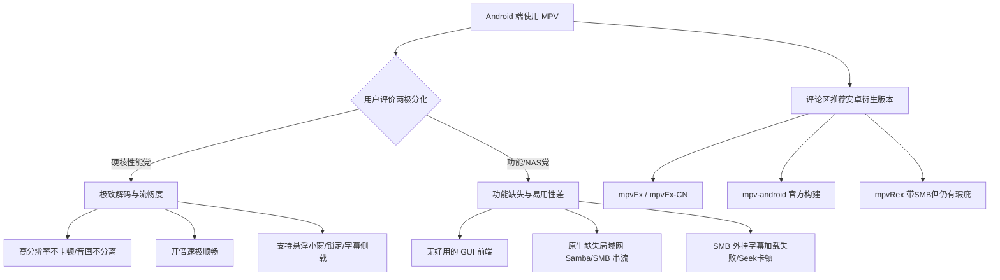

# B站视频中关于 Android（安卓）平台 MPV 的专项评论分析

## 一、 数据概述

- **筛选范围**：从全部 816 条评论中深度筛选同时涉及 **MPV** 与 **Android / 安卓 / 手机移动端** 的讨论。
- **匹配结果**：共筛选出 **34 条** 高度相关评论（包含主评与楼中楼深度对话）。
- **导出文件位置**：
  - CSV 表格（含 Excel 友好编码）：[mpv_android_comments.csv](file:///d:/program/Android/Gyro/mpv_android_comments.csv)
  - 完整 JSON 数据：[mpv_android_comments.json](file:///d:/program/Android/Gyro/mpv_android_comments.json)

---

## 二、 安卓端 MPV 的核心争论焦点与使用现状

综合 34 条评论，观众对在 Android 上使用 MPV 的态度呈现出非常鲜明的两极分化：

---

## 三、 评论区推荐的 Android 端 MPV 客户端

针对原生 MPV 在移动端界面简陋、交互不便的问题，评论区提到了以下项目：

| 项目名称 | 提及用户与讨论背景 | 特性与评论反馈 |
| :--- | :--- | :--- |
| **mpvEx** / **mpvEx-CN** | **栗楔**、**RyuuliOn_**、**公子駱** | GitHub 开源项目，基于 libmpv 针对手机手势和交互做了优化；有国内用户制作的汉化版 `mpvEx-CN`。 |
| **mpv-android** | **Player9**、**超級無敵霹靂啪啦的餅乾** | 官方构建版本，纯粹基于 libmpv，适合从其他应用/文件管理器调用打开。 |
| **mpvRex** | **峡雨** | 基于 libmpv 并尝试加入了 SMB 局域网协议支持，但用户实测拖动进度条（Seek）时有卡顿，且不支持 SMB 目录下的外挂字幕。 |
| **自研/第三方开发** | **bishojo** (获赞 16) | 开发者评论：*“受不了 MX 了，所以正在基于 mpv 开发 android 端的播放器”*。 |

---

## 四、 精选重点评论与争论实录

### 1. 深度对线：性能极致 vs 局域网功能残缺

评论区围绕 **峡雨** 与 **窝黑** 展开了多轮关于安卓端 MPV 的辩论，非常具有代表性：

> **用户【峡雨】（获赞 7）**：  
> *“功能缺失太多，不是一个完整的播放器。举个例子我最看重的局域网播放功能就没有，我的电影存放在NAS上用Samba共享的，mpv没有内置的Samba流式播放功能。我在linux上也用mpv，但mpv在android上缺少一个功能完整的前端，使得它的可用性大打折扣。可用性易用性远比某个特定场景下的性能重要，那我只能选择vlc。”*

> **用户【窝黑】**：  
> *“Mpv的播放确实好过其它播放器，我用过很多的播放器在播放高分辨率的视频会卡顿或者直接音频分离，但mpv没事，开倍速也不卡。我一般都是从别的软件或相册使用mpv播放，一般上能支持倍数播放，随拉随播，支持锁定，小窗，字幕侧载，网络视频播放已经很够了，我不常在手机mpv应用里开视频。smb协议我不会用到，再加下去也只会让播放器更加臃肿，比起额外的功能还不如让视频播放起来流畅。”*

---

### 2. 替代品与多设备跨端搭配

不少用户分享了自己在不同设备上的折中搭配策略：

- **典型搭配一（PC 极客 + 手机省心）**：
  - **ffuqiangg（获赞 10）**：*“三款我都在用，android 用 vlc ，windows 用 potplayer ，linux 用 mpv 。”*
  - **CamA（获赞 2）**：*“Windows用mpv，安卓用VLC”*
  - **平Fan_D世界（获赞 1）**：*“安卓用VLC，电脑用mpv”*
- **MX Player 堕落后的选择**：
  - 评论中频繁提及 MX Player 被印度公司收购后广告泛滥、沦为流媒体应用，促使用户寻找替代品；但在安卓局域网 SMB 支持和 ASS 字幕渲染上，目前仍缺乏一个像 PC 端 MPV 那样压倒性完美的王者。
- **进阶玩法**：
  - **时间鸟（获赞 1）**：*“在windows上可以用命名管道远程控制mpv客户端，于是我就可以写程序让这玩意儿支持dlna，然后手机就能投屏到pc了。”*
