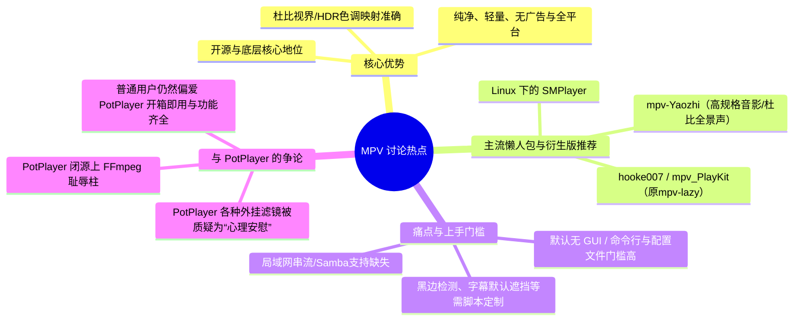

# B站视频关于 MPV 播放器的评论抓取与分析报告

## 一、 抓取概述

- **目标视频**：[【VLC、PotPlayer、MPV怎么选？优缺点一次讲透】](https://www.bilibili.com/video/BV1FfKr6iELb/)
- **抓取范围**：该视频下的全部主评论与楼中楼展开回复（共抓取 816 条评论数据）
- **MPV 相关评论总数**：**160 条**（涉及 89 个独立讨论主题帖）
- **导出文件位置**：
  - CSV 表格（含 Excel 友好编码）：[mpv_comments.csv](file:///d:/program/Android/Gyro/mpv_comments.csv)
  - 完整 JSON 数据：[mpv_comments.json](file:///d:/program/Android/Gyro/mpv_comments.json)

---

## 二、 核心观点与讨论维度总结

根据对 160 条评论的内容挖掘，观众针对 MPV 的讨论主要集中在以下四个核心维度：

---

## 三、 高赞热评精选与分类解读

### 1. 核心优势与开源生态支持（为什么转投 MPV）

| 用户 | 获赞数 | 发布时间 | 核心发言摘要 |
| :--- | :--- | :--- | :--- |
| **SAR-米其林厨师长** | 172 | 2026-07-22 | *“mpv现在是跨平台最好的开源播放器，vlc也开源，但是只适合不想客制化的，potplayer不开源，就ffmpeg套一个壳，还上过ffmpeg的耻辱柱，不如前两个呢”* |
| **Oneize** | 139 | 2026-07-20 | *“转战mpv的原因就是，当初下了一部杜比视界影片，尝试了qq影音，暴风，恒星，win自带，vlc，pot，要么无法播放，要么没有颜色，看到有人推荐mpv，试了下完美播放，太强了，快，干净清爽。还有稍微学习下，还能自己修改定制脚本”* |
| **DJJJJJJJ01** | 65 | 2026-07-20 | *“pot给我的感觉是屎山代码有点多，然后有一点不流畅的感觉，vlc过于简陋，ui也丑。mpvkit最简单易用且全面（原来叫mpvlazy）。现在就用mpv了，而且sdr的屏幕pot播放会偏色，但是mpv播放就正常色调了，不需要折腾”* |
| **哔小哩和哔大哩** | 16 | 2026-07-30 | *“pot是皮，mpc、mpv和vlc三个是核级别的”* |

> [!NOTE]
> **画质与色彩映射**是大部分资深用户从 PotPlayer 转入 MPV 的首要诱因，尤其是播放 **HDR、Dolby Vision 片源在 SDR 显示设备上的色彩转换**，MPV 的着色器算法被广泛认为显著优于 PotPlayer 默认配置。

---

### 2. 社区推荐的 MPV 衍生版本与懒人包

原版 MPV 由于默认仅有极简黑框，评论区高频推荐了以下国内活跃维护的配置包与衍生项目：

1. **hooke007 / mpv_PlayKit (原 mpv-lazy)**
   - 评论中被提及次数最多（超 20 次提及）。
   - GitHub: [hooke007/mpv_PlayKit](https://github.com/hooke007/mpv_PlayKit)
   - 特点：国内最流行的 Windows 开箱即用整合包，集成了右键菜单、OSC 界面增强以及常用着色器。
2. **mpv-Yaozhi**
   - 获赞 92（评论区开发者现身推荐）。
   - GitHub: [Yaozhil/mpv-Yaozhi](https://github.com/Yaozhil/mpv-Yaozhi)
   - 特点：重编译内核，主打 HDR10+、Dolby Vision P5/P7/P8、Audio Vivid、Dolby Atmos 5.1.4~9.1.6 空间音频，并内置 WebDAV/Alist 挂载支持。
3. **SMPlayer / mpv.net**
   - 针对想要传统 GUI 窗口播放器操作习惯（顶部菜单栏、右键播放列表）的跨平台用户。

---

### 3. 反对意见与痛点吐槽（为什么有人弃用或不推荐 MPV）

虽然 MPV 性能上限极高，但许多普通用户与功能型用户在评论区指出了其不可忽视的短板：

| 用户 | 核心痛点与评价 |
| :--- | :--- |
| **峡雨** | **局域网 NAS 流式播放缺失**：*“功能缺失太多，不是一个完整的播放器。举个例子我最看重的局域网播放功能就没有，我的电影存放在NAS上用Samba共享的，mpv没有内置的Samba流式播放功能。”* |
| **无水乙醇99** | **普通人配置门槛过高**：*“MPV很强大，但是配置也很麻烦，普通人还是不要碰，或者用别人配置好的版本。”* |
| **熊大你又骗俺** | **硬解资源占用与画质神话**：*“MPV是这几年吹的最响的，而我之前做过测试，能硬解的情况下，MPV是真没比potplayer强，无论是资源占用还是视频效果方面。很多人把外挂滤镜吹成玄学。”* |
| **阴影之刃** | **UI与字幕默认习惯**：*“mpv你不觉得默认设置严重挡字幕吗，不过我没用过这款，也许能调...欧美用户默认不开字幕，台词纯靠听，存在习惯差异。”* |

> [!WARNING]
> 对于需要 **开箱即用图形化控制面板**、**局域网直接扫描挂载**、**简易外挂字幕延时微调** 的非极客用户，直接使用原生 MPV 可能会遇到配置壁垒，必须搭配懒人包或 GUI 前端。

---

## 四、 本地数据字段说明

已在工作区生成的 `mpv_comments.csv` 包含以下字段：

| 字段名称 | 说明 |
| :--- | :--- |
| `rpid` | B站评论唯一 ID |
| `type` | 评论层级（`主评` 或 `楼中楼回复`） |
| `user` | 发评用户名 |
| `likes` | 获赞数（已按此项降序排列） |
| `rcount` | 该主评下的总回复数 |
| `time` | 评论发布时间格式化字符串 |
| `message` | 评论完整正文内容 |
| `root_user` | 所属主评楼层作者（便于查看上下文脉络） |
| `root_message`| 所属主评楼层原文 |
