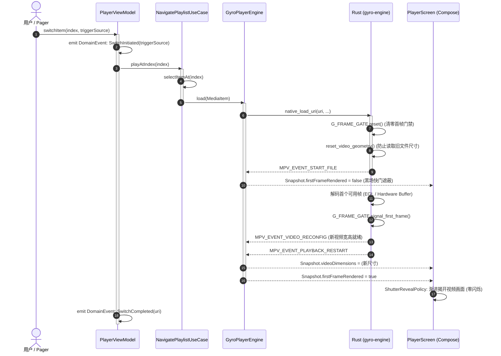
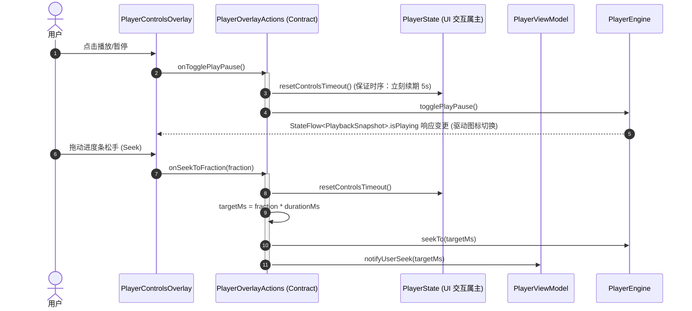
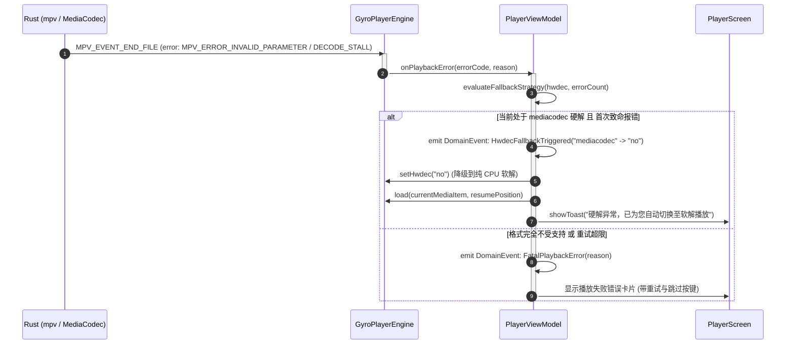

# PlayerViewModel 领域接口与交互时序设计

> 对应 [player_state_ownership.md](player_state_ownership.md) 第二节。
> 目标：将 ViewModel 从简单的代理转发器（Forwarder）演进为具备时序推演自闭环的领域状态中心，
> 同时严格遵守“快照解包不下沉”、“Actions 契约化移位”以及“时序不变量 CI 化”三大设计约束。

---

## 一、 核心设计约束回顾

1. **快照解包不下沉（No Snapshot Passthrough Boilerplate）**
   - 屏幕现有的 `snapshot.xxx` 是展示层的只读投影，直接订阅 `engine.state`；
   - ViewModel **绝对不**做 `val isPlaying = engine.state.map { it.isPlaying }` 这种机械搬砖，避免增加一层无意义的调度间接。
2. **ViewModel 的正向增量是“领域事件与意图收敛”（Domain Events & Intents）**
   - 换片来源（手动点击列表、短视频纵向滑卡、播放完毕自动下一集、外部 Intent）；
   - 播放异常与故障诊断（文件不存在、解码器崩溃、格式不受支持、权限缺失）；
   - 硬解回退协商（MediaCodec 失败自动回退到软解）。
3. **Actions 构造移位（Action Factory Hoisting）**
   - 将 `PlayerScreen.kt` 中分散构造的 `PlayerOverlayActions` 收拢到领域工厂函数 `rememberPlayerScreenActions(...)`，组件签名保持只读契约。

---

## 二、 交互时序序列图（Interaction Sequence Diagrams）

### 1. 换片流转与首帧门禁时序（Track Switch & First Frame Gate）

该时序解决了“切片黑屏”、“快照数据撕裂”和“旧视频几何污染”的关键不变量约束。



---

### 2. 控制层行为契约分发时序（Overlay Actions & Auto-Hide Invariant）

控制层所有用户行为（Play/Pause, Seek, Track, Orientation, PiP）由单一动作对象 `PlayerOverlayActions` 承载，保证“触发行为必定重置自动隐藏计时器”。



---

### 3. 解码故障与自动降级时序（Decoder Fallback Flow）

解决硬解黑屏或崩溃时，UI 层无感知、无限等待的痛点。



---

## 三、 领域接口（Domain API）具体定义

### 1. 领域模型与事件（Domain Models & Events）

在 `feature:player` 中建立独立的领域抽象：

```kotlin
package dev.gyro.feature.player.domain

import android.net.Uri

/** 播放切换的意图来源 */
enum class PlaybackTriggerSource {
    USER_PLAYLIST_CLICK,
    SHORT_VIDEO_SWIPE,
    AUTO_PLAY_NEXT,
    SYSTEM_INTENT,
    RESTORE_FROM_BACKGROUND
}

/** 播放故障分类 */
sealed interface PlaybackFailureReason {
    data class DemuxError(val message: String) : PlaybackFailureReason
    data class CodecCrash(val codecName: String) : PlaybackFailureReason
    data class FileNotFound(val uri: Uri) : PlaybackFailureReason
    data class PermissionDenied(val uri: Uri) : PlaybackFailureReason
    data object Unknown : PlaybackFailureReason
}

/** 供上层/UI 订阅的轻量领域事件（不承载逐帧高频数据） */
sealed interface PlayerDomainEvent {
    data class SwitchInitiated(val fromIndex: Int, val toIndex: Int, val source: PlaybackTriggerSource) : PlayerDomainEvent
    data class SwitchCompleted(val index: Int, val uri: Uri) : PlayerDomainEvent
    data class HwdecAutoFallback(val from: String, val to: String) : PlayerDomainEvent
    data class ErrorOccurred(val reason: PlaybackFailureReason) : PlayerDomainEvent
}
```

---

### 2. Actions 契约工厂函数方案（Hoisting `PlayerOverlayActions`）

从 `PlayerScreen.kt` 剥离散乱的 lambda 组装逻辑：

```kotlin
package dev.gyro.feature.player

import android.app.Activity
import android.content.pm.ActivityInfo
import android.content.res.Configuration
import androidx.compose.runtime.Composable
import androidx.compose.runtime.remember
import dev.gyro.engine.api.PlayerEngine
import dev.gyro.feature.player.component.PlayerOverlayActions
import dev.gyro.feature.player.domain.PlaybackTriggerSource

@Composable
fun rememberPlayerScreenActions(
    engine: PlayerEngine,
    viewModel: PlayerViewModel,
    playerState: PlayerState,
    screenshotController: PlayerScreenshotController,
    activity: Activity?,
    configuration: Configuration,
    onBack: () -> Unit,
    durationMsProvider: () -> Long,
    timePosMsProvider: () -> Long,
    surfaceViewProvider: () -> dev.gyro.engine.ui.GyroSurfaceView?,
    mediaTitleProvider: () -> String,
    subtitleEnabled: Boolean,
    lastSubTrackId: Int,
    seekStepSeconds: Int = 10,
): PlayerOverlayActions {
    return remember(engine, viewModel, playerState, screenshotController, activity, configuration) {
        PlayerOverlayActions(
            onTogglePlayPause = {
                playerState.resetControlsTimeout()
                engine.togglePlayPause()
            },
            onToggleLock = {
                playerState.resetControlsTimeout()
                playerState.isLocked = !playerState.isLocked
                playerState.showControls = !playerState.isLocked
            },
            onSeekToFraction = { fraction ->
                playerState.resetControlsTimeout()
                val target = (fraction * durationMsProvider()).toLong()
                engine.seekTo(target)
            },
            onEnterPiP = {
                // 由外部 pipState 托管
            },
            onOpenSheetTab = { tab ->
                playerState.hideControls()
                playerState.activeSheetTab = tab
            },
            onToggleOrientation = {
                activity?.let { act ->
                    val isLandscape = configuration.orientation == Configuration.ORIENTATION_LANDSCAPE
                    act.requestedOrientation = if (isLandscape) {
                        ActivityInfo.SCREEN_ORIENTATION_SENSOR_PORTRAIT
                    } else {
                        ActivityInfo.SCREEN_ORIENTATION_SENSOR_LANDSCAPE
                    }
                }
            },
            onBack = {
                viewModel.onUserExit()
                onBack()
            },
            onPlayPrevious = {
                playerState.resetControlsTimeout()
                viewModel.playPrevious()
            },
            onPlayNext = {
                playerState.resetControlsTimeout()
                viewModel.playNext()
            },
            onSelectPlaylistItem = { idx ->
                playerState.resetControlsTimeout()
                viewModel.playAtIndex(idx)
            },
            onRewind10 = {
                playerState.resetControlsTimeout()
                engine.seekRelative(-seekStepSeconds * 1000L)
            },
            onForward10 = {
                playerState.resetControlsTimeout()
                engine.seekRelative(seekStepSeconds * 1000L)
            },
            onToggleSubtitle = {
                playerState.resetControlsTimeout()
                if (subtitleEnabled) {
                    engine.trackManager.selectTrack("sub", 0)
                } else {
                    engine.trackManager.selectTrack("sub", lastSubTrackId.coerceAtLeast(1))
                }
            },
            onCycleAbLoop = {
                playerState.resetControlsTimeout()
                engine.cycleAbLoop()
            },
            onScreenshot = {
                playerState.resetControlsTimeout()
                screenshotController.capture(
                    surfaceView = surfaceViewProvider(),
                    mediaTitle = mediaTitleProvider(),
                    positionMs = timePosMsProvider()
                )
            },
            onCycleHwdec = {
                playerState.resetControlsTimeout()
                engine.cycleHwdec()
            }
        )
    }
}
```

---

## 四、 CI 时序不变量锚点清单更新

在后续实现本设计时，需同步落地以下纯 JVM 单元测试：

1. **`PlayerDomainEventTest`**：
   - 验证切换模式（ShortVideo vs PlaylistClick）准确派发对应的 `PlaybackTriggerSource`；
   - 验证发生 `FatalPlaybackError` 时自动触发软解重试状态流转。
2. **`rememberPlayerScreenActionsInvariantTest`**：
   - 验证所有 actions 触发时，`resetControlsTimeout()` 得到 100% 调用的时序不变量；
   - 验证 Seek 操作的数学边界与 `seekTo` 目标参数严格一致。
